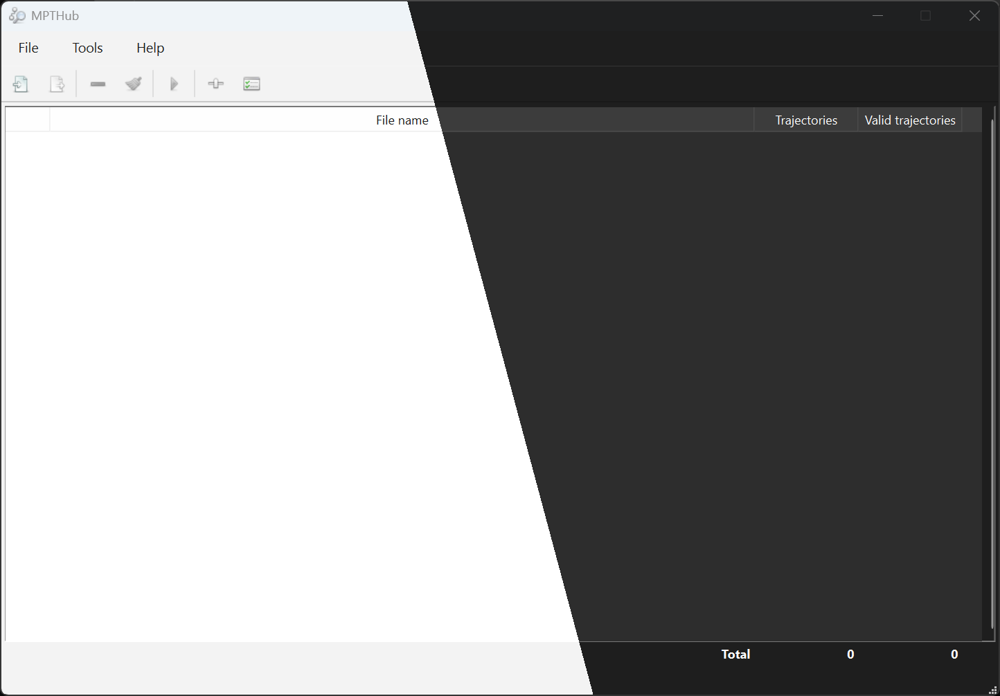

# MPT Analysis

Multiple Particle Tracking Analysis application that generates reports with organized information about particle displacement, helping to analyze data from video microscopy generated by ImageJ (using the Mosaic plugin).

<p align="center">
  
</p>

> **Looking for how to install and use the app?** See the complete user documentation on the [Wiki](https://github.com/lassisg/mpthub/wiki).

## Status

| Platform | Support |
|---|---|
| Windows | ✅ Stable (installer available) |
| Linux | 🚧 Planned |
| macOS | 🗓️ Future |

## Features

- Reads trajectory tables exported by ImageJ's Mosaic plugin (`.csv`)
- Filters and validates trajectories for statistical analysis (~100 valid trajectories recommended)
- Generates analysis reports in `.xlsx` format:
  - Effective diffusivity (Deff) — individual and ensemble
  - Transport mode characterization (immobile, sub-diffusive, diffusive, active)
  - Einstein–Stokes calculation (D0/Dw ratio and microviscosity)

## Getting Started (development)

### Prerequisites

- Windows 10/11
- [Python 3.11](https://www.python.org/downloads/) (`>=3.9,<3.12`)
- [Poetry](https://python-poetry.org/)
- [NSIS](https://nsis.sourceforge.io/) — only to build the installer

### Setup

```powershell
# Install Python and Poetry (see Wiki for details)
winget install Python.Python.3.11
(Invoke-WebRequest -Uri https://install.python-poetry.org -UseBasicParsing).Content | py -3.11 -

# Clone and install dependencies
git clone https://github.com/lassisg/mpthub.git
cd mpthub
poetry install
```

### Run

```powershell
poetry run python app.py
```

<!-- ### Tests

```powershell
poetry run pytest
``` -->

### Build the installer

```powershell
poetry run build_mpt          # PyInstaller executable
# Then compile MPTHub_Installer.nsi with NSIS
```

The built installer is published on [Releases](https://github.com/lassisg/mpthub/releases).

## Roadmap

- [x] Windows installer
- [ ] Upgrade to SQLAlchemy 2.x and modern pandas
- [ ] Linux build
- [ ] macOS build

## Contributing

Issues and pull requests are welcome. For major changes, please open an issue first to discuss what you would like to change.

## License

Distributed under the [MIT License](LICENSE).

## Author

**Leandro Gabriel** — [lassisg](https://github.com/lassisg)
